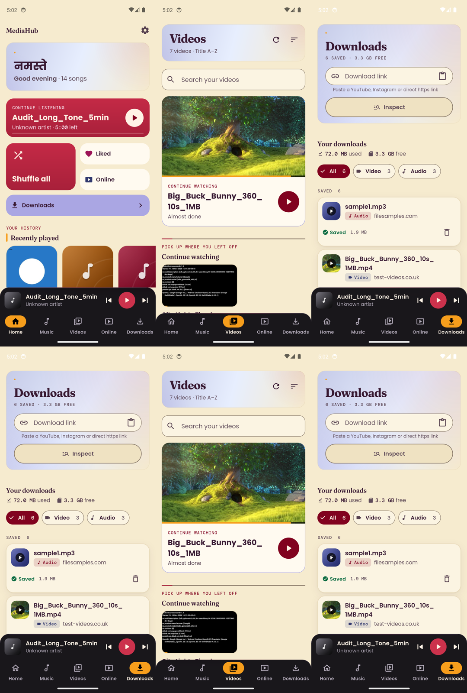
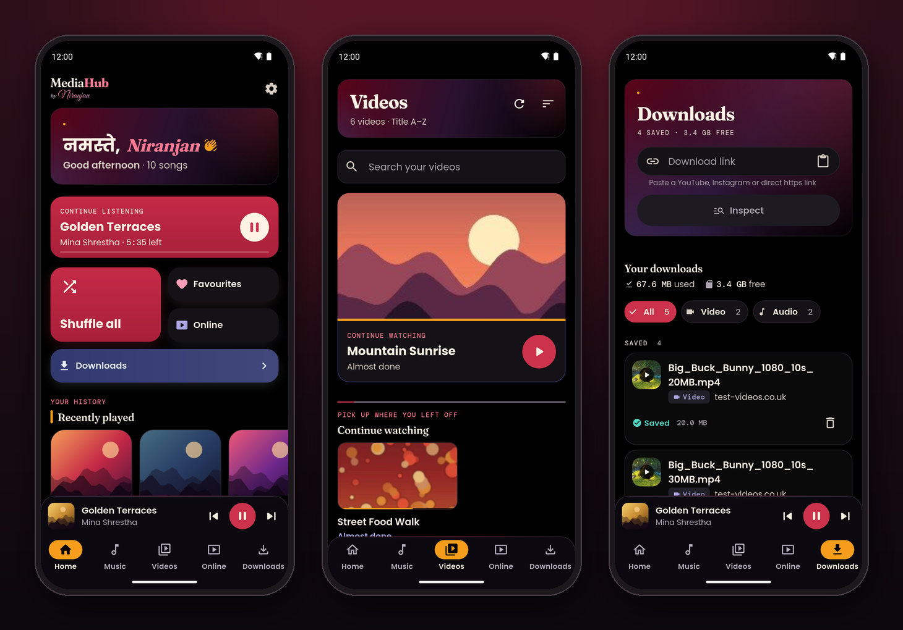
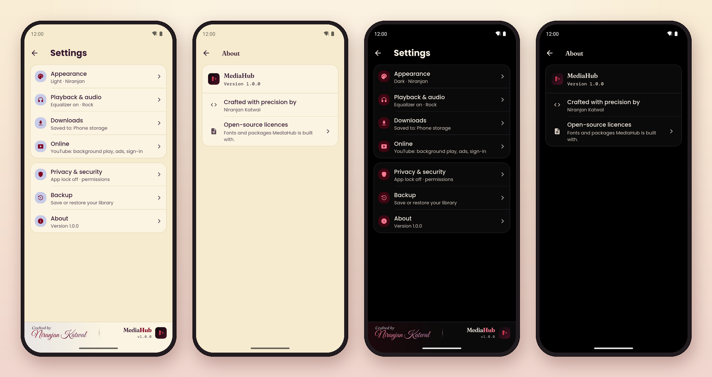
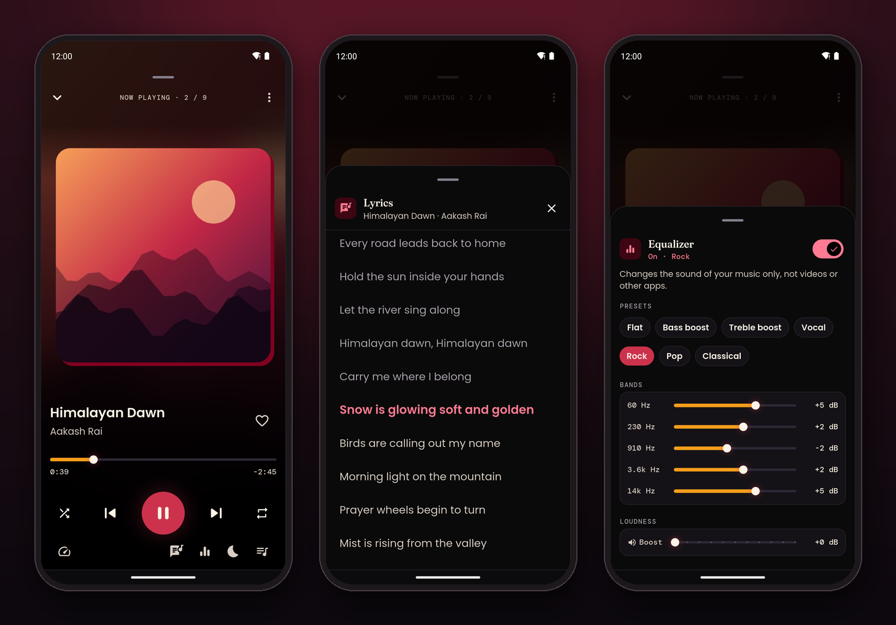
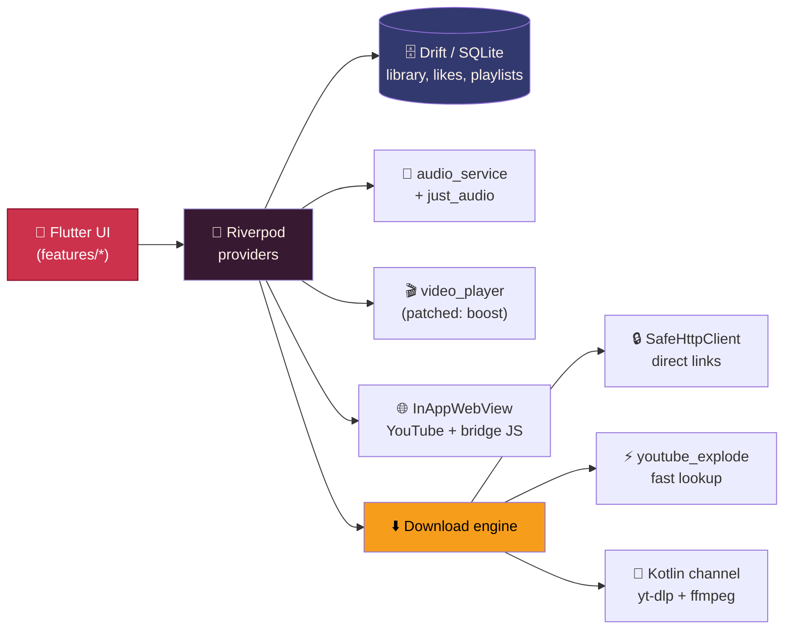

<!-- ───────────────────────────── HEADER ───────────────────────────── -->
<div align="center">




<a href="https://github.com/itsniranjannn/mediahub">
  
</a>

<br/>


<br/>


**[Features](#-features) · [Screens](#-screens) · [Design](#-design-system-sindur) · [Architecture](#-architecture) · [Security](#-security--privacy) · [Build](#-getting-started) · [Roadmap](#-roadmap)**

</div>

---

## 🎧 What is MediaHub?

**MediaHub** is a private, all-in-one media app for the family: play the songs and videos already on the phone,
browse YouTube with background play and picture-in-picture, and save anything offline in the quality you want.
Everything stays on the phone — **no account, no analytics, no cloud**.

> [!TIP]
> Set your name in **Settings → You → Your name** and Home greets you with an animated **"नमस्ते, &lt;your name&gt;"**.

---

## ✨ Features

<table>
<tr>
<td width="50%" valign="top">

### 🎵 Music
- Play, pause, next/previous with **burst-safe** fast taps
- Shuffle, repeat (off / all / one), drag-to-reorder **queue**
- **Favourites**, playlists, albums, artists, smart search
  (finds रेशम फिरिरी from *"resham"*)
- Sleep timer with fade-out, playback speed
- Lock-screen, notification, Bluetooth & car controls
- **Android Auto**: browse Songs, Albums, Playlists, Favourites
- **Lyrics** from the file or a `.lrc`, synced scrolling; LRCLIB lookup (opt-in, with title cleanup & search fallback)
- **Equalizer** presets, custom bands and loudness boost (Android)
- Pauses for other apps and **resumes by itself**
- **Delete from phone** for the phone's own songs (Android's consent dialog)

</td>
<td width="50%" valign="top">

### 🎬 Video
- ±10 s buttons, **double-tap seek**, pinch & fit modes
- Auto landscape / portrait by the video's shape
- **Volume boost** up to 200 % (video audio only)
- Picture-in-picture, subtitles (`.srt` / `.vtt`), audio tracks
- *Continue watching* with amber progress lines
- "Play as audio" hands a video to the music player

</td>
</tr>
<tr>
<td valign="top">

### 🌐 Online (YouTube)
- The full mobile YouTube site inside the app
- **Background play** with the screen off — and it **keeps playing when you clear the app** (hands over to the native player instantly)
- Play / pause from the notification any number of times after a swipe-away
- **Picture-in-picture** that keeps playing
- **Block ads** (on by default) — video ads pruned, sponsored boxes hidden
- Google sign-in on Google's own page (the app never sees the password)
- One-tap **Download** / **Copy link** from the watch page

</td>
<td valign="top">

### ⬇️ Downloads
- Paste a YouTube, Instagram, TikTok… or direct `https` link
- **Share to MediaHub** from YouTube, Instagram, TikTok, Facebook or a browser: the link opens in Downloads, ready to pick a quality (Android)
- **Video** qualities up to 2160p, labelled with real sizes
- **Audio**: MP3 **320 / 256 / 192 / 128 kbps** or original M4A / Opus
- Videos land in *Videos*, sound in *Music* — automatically
- **Save to phone**: into Music/MediaHub and Movies/MediaHub (Gallery, Files), per download or for all
- yt-dlp **built in**, self-updating with checksum verification; IPv4/IPv6 racing
- **Pause & resume** that continues from the same byte — even after the app is closed; *Resume all* from the notification
- **Choose where downloads go**: inside MediaHub (private) or phone storage
- Clean list: 5 newest + *Show all*

</td>
</tr>
</table>

<details>
<summary><b>🧩 More details (click to expand)</b></summary>

| Area | Highlights |
|---|---|
| Home | Animated greeting hero, *Continue listening* card, bento quick-actions with shine sweep, rails for Recently played · Most played · Recently added · Favourites |
| Settings | Short grouped list (Appearance · Playback & audio · Downloads · Online · Privacy & security · Backup · About), animated planet backdrop with translucent cards, pinned signature footer, theme picker (System · Dark · Light · **Bijuli Classic**), your name, equalizer & online lyrics, **App lock** (fingerprint / face / PIN, whole app or Downloads + Online), Online, downloads, backup & restore |
| Accessibility | WCAG-checked contrast in every theme, large-text safe (tested at 1.3×), reduced-motion respected, screen-reader labels |
| Nepali | Devanagari drawn natively in every name and body style (Poppins) |
| Reliability | Decoder hiccups retried quietly, stuck downloads end cleanly, free-space check before saving, caches capped and cleaned (lyrics, covers, partial files) |

</details>

---

## 📱 Screens

<div align="center">

**Sindur light** — Home · Videos · Downloads



**Sindur dark** — Home · Videos · Downloads



**Settings and About** — the compact list with the pinned signature footer; About holds the open-source licences (light and dark)



**Now playing** — the player, synced lyrics and the equalizer (the player is always dark)



<sub>Captured on the Android emulator (release build) with demo media.</sub>

</div>

---

## 🎨 Design system: Sindur

> **Sindur** (सिन्दूर) — the crimson of tika: festive red on black and on light sand.

<div align="center">

| Dark | | Light | |
|---|---|---|---|
|  | Black canvas `#000000` |  | Light sand `#F6EBCF` |
|  | Crimson fill `#CC324C` |  | Wine red `#81021F` |
|  | Rose accent `#FF7A92` |  | Lavender `#AAA6E3` |
|  | Plum `#381932` |  | Periwinkle `#C6CBE8` |
|  | Amber spark `#F69E1C` |  | Indigo `#32396F` |
|  | Milk text `#FFF3E6` |  | Plum text `#381932` |

</div>

- **Type:** *Fraunces* for headings · *Poppins* for names and reading text (Latin + Devanagari) · *DM Mono* for times and sizes · *Great Vibes* for the author signature
- **Signature pieces:** the dark **Ink Dock** (mini player + nav, same in both themes), crimson **sticker** buttons with a soft glow, glowing hero bands, amber section marks
- **Motion:** press-scale 0.97, shine sweeps, entrance fades — all switched off with *reduce motion*
- **Bijuli Classic:** the original lime-on-violet look, kept as an optional theme
- Full spec: [`docs/DESIGN.md`](docs/DESIGN.md) — every colour pair is contrast-tested in `test/unit/palette_contrast_test.dart`

---

## 🏗️ Architecture



<details>
<summary><b>📂 Project layout</b></summary>

```text
lib/
├── app/          # theme (Sindur + Bijuli Classic), router, shell
├── core/         # security, storage, logging, downloads, platform
├── data/         # Drift database, repositories, download runners
├── features/     # home · library · music_player · video_player
│                 # online · downloads · playlists · settings
├── personal/     # yt-dlp backend, format options, quality sheet
└── shared/       # ui_kit (buttons, tiles, hero bands), ink dock
android/          # Kotlin: yt-dlp channel, device controls, PiP
ios/              # Swift + Codemagic workflow
docs/             # DESIGN, HANDOFF, ROADMAP, IOS, DECISIONS
test/             # ~1,900 unit + widget tests, JS bridge tests
```

</details>

---

## 🔐 Security & privacy

| | |
|---|---|
| 📵 **Minimal permissions** | Audio, video, notifications, internet, foreground media service — no contacts, location, camera or mic |
| 🔒 **HTTPS only** | Cleartext disabled; bad certificates are always refused (with a clear message on networks that inspect HTTPS) |
| 🏠 **No private-network access** | Every download address is checked and pinned before connecting |
| 🧪 **Sandboxed YouTube** | Only YouTube and Google sign-in hosts load; the JS bridge needs a per-page secret and is off on sign-in pages |
| 💾 **Data stays local** | No account, no analytics, no cloud backup; diagnostics strip links and paths |
| 🔐 **App lock** | Fingerprint / face / PIN; hides the app in Recents and blocks screenshots while on; can't be skipped by PiP or by changing the clock |
| 🛡️ **Verified updates** | yt-dlp updates are checked against the official SHA-256 sums before install |
| ✍️ **Signed releases** | Release builds are R8-shrunk, not debuggable, and refuse to build without the private signing key |
| ©️ **Proprietary** | All rights reserved — see [`LICENSE`](LICENSE); every source file carries the copyright notice |

---

## 🚀 Getting started

```bash
# 1. Get the code
git clone https://github.com/itsniranjannn/mediahub.git
cd mediahub

# 2. Install packages
flutter pub get

# 3. Check everything
dart analyze lib test
flutter test
node --test test/js/youtube_bridge_test.js

# 4. Run on a device or emulator
flutter run
```

<details>
<summary><b>📦 Release builds</b></summary>

```bash
# Signed release APK (needs android/key.properties + your keystore — never commit them)
bash tools/device/build_apks.sh family

# Refresh the bundled yt-dlp from PyPI before a release
python tools/device/update_ytdlp_asset.py
```

iOS builds run on Codemagic (`codemagic.yaml`); see [`docs/IOS.md`](docs/IOS.md).

</details>

---

## 🗺️ Roadmap

- [x] Sindur redesign — new colours, fonts, Home, Videos, Downloads
- [x] Video / Audio quality sections with MP3 bitrates
- [x] Built-in yt-dlp, ad blocker, PiP that keeps playing
- [x] Library backup & restore file
- [x] Smaller APK (64-bit only)
- [x] Save downloads to the phone's Music / Movies folders
- [x] Delete the phone's own songs and videos from MediaHub
- [x] App lock (fingerprint / face / PIN)
- [x] Lyrics (synced), equalizer, Android Auto browsing
- [x] Share links into MediaHub from other apps (Android)
- [ ] First run on a real iPhone

See [`docs/ROADMAP.md`](docs/ROADMAP.md) for the full list.

---

<div align="center">

### 👨‍💻 Author

**Niranjan Katwal**
<br/>
<a href="https://github.com/itsniranjannn"></a>

<sub>Copyright © 2026 Niranjan Katwal. All rights reserved. See <a href="LICENSE">LICENSE</a>.</sub>


</div>
